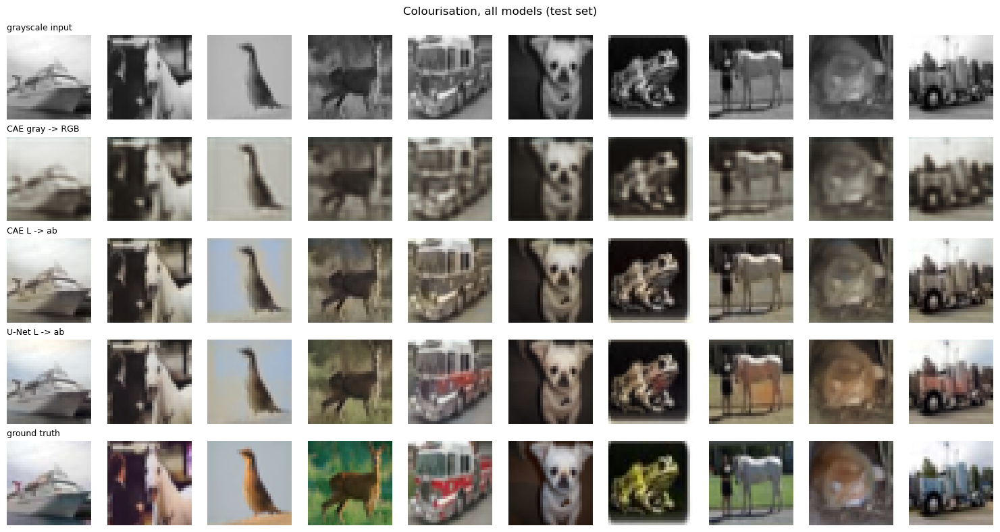

# Coloriser des photos noir et blanc avec un CNN

Un réseau encodeur-décodeur (PyTorch) qui reçoit une image en noir et blanc et prédit ses couleurs, entraîné sur
CIFAR-10. Tout tient dans un notebook : [`colorisation_cnn.ipynb`](colorisation_cnn.ipynb).

[](https://colab.research.google.com/github/flingzi-maximax/cnn-deeplearning/blob/main/colorisation_cnn.ipynb)



*Ligne 2 : un 3e essai qui prédit directement RGB au lieu de ab (moins bon, gardé pour comparer).*

## L'idée en 3 lignes

1. On passe les images dans l'espace de couleur **Lab** : **L** = la luminosité (la photo noir et blanc), **a** et **b** = la couleur.
2. Le réseau reçoit L et ne prédit **que a et b** : il n'a pas à redessiner l'image, juste à la colorier.
3. On recolle a et b prédits sur le vrai L et on repasse en RGB.

## Résultats (images de test)

| Modèle | Paramètres | Erreur (MSE RGB) | Chroma moyenne |
| --- | --- | --- | --- |
| Noir et blanc recopié (référence) | 0 | 0,00659 | 0,00 |
| Autoencodeur L → ab | 446 | 0,00600 | 6,74 |
| U-Net L → ab | 117 410 | 0,00506 | 9,55 |

Les vraies images ont une chroma de 14,55 : les modèles colorisent encore trop timidement, la MSE les pousse vers
des couleurs « moyennes ». Les chiffres peuvent bouger un peu d'une machine à l'autre.

## Lancer le notebook

- **Le plus simple :** [ouvre le notebook dans Google Colab](https://colab.research.google.com/github/flingzi-maximax/cnn-deeplearning/blob/main/colorisation_cnn.ipynb), active le GPU (Exécution → Modifier le type
  d'exécution) et lance tout. CIFAR-10 se télécharge tout seul.
- **En local :**

```bash
pip install -r requirements.txt
jupyter notebook colorisation_cnn.ipynb
```

Sur CPU l'entraînement prend du temps (surtout le U-Net) ; sur GPU, quelques minutes.

## Les outils utilisés

Python · Jupyter · NumPy · pandas · Matplotlib · PyTorch · torchvision · scikit-image
